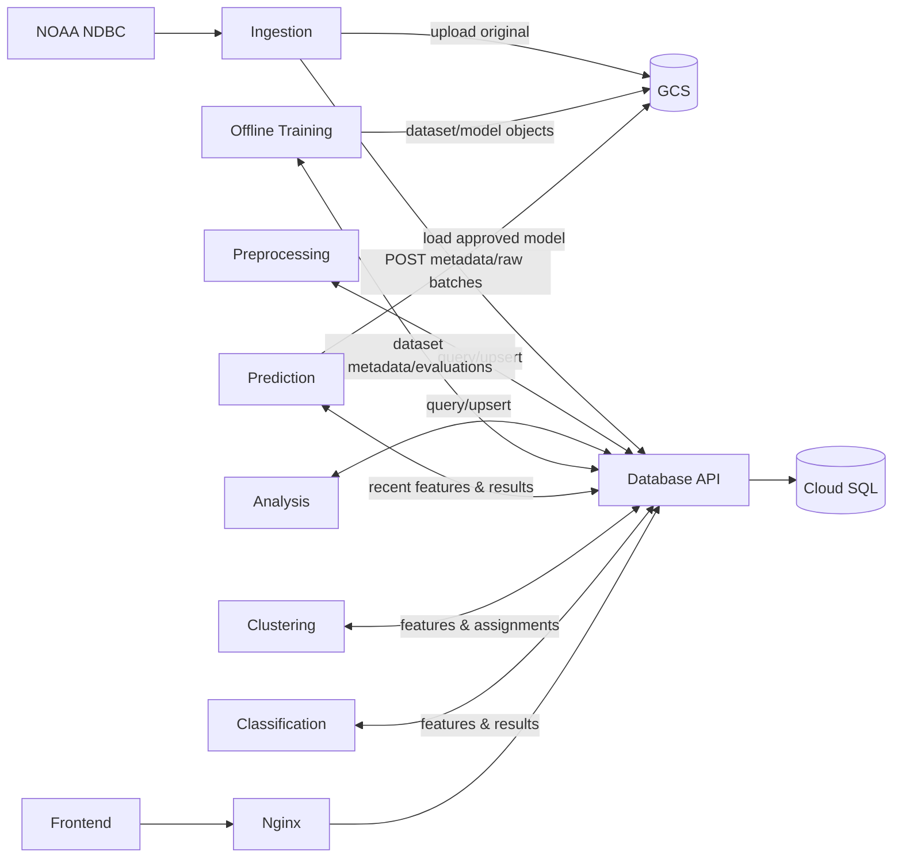

# 01 — Yêu cầu cuối kỳ & kiến trúc tổng thể

## 1. Ranh giới giữa yêu cầu môn học và thiết kế do nhóm đề xuất

**Căn cứ từ tài liệu lớp** (`TONG_HOP_KIEN_THUC_VA_DO_AN_CUOI_KY.md`, tuần 6–10, bản tổng hợp ghi âm): Dữ liệu nguồn có cập nhật; ingestion; Database/API; các service Analysis, Clustering, Prediction, Classification; API cấp dữ liệu cho frontend; dashboard ngày/tuần/tháng, trend, seasonality, correlation; dữ liệu kết quả pattern có thể xóa và tạo lại; mô hình đã huấn luyện không được train lại trong demo; triển khai Docker Compose, báo cáo sơ đồ khối/sơ đồ mạng. Mốc 5 phút trong slide là ví dụ về lịch chạy, không ép nguồn NOAA phải có điểm mới mỗi 5 phút.

**Lựa chọn thiết kế của nhóm (không phải chỉ định của thầy):** FastAPI, Python 3.13, PostgreSQL 17 Cloud SQL, GCS, một trạm 51201, polling 30 phút, K-means, RandomForestRegressor và RandomForestClassifier/LogisticRegression baseline, timezone Hawaii; 7 service nghiệp vụ + scheduler + training offline; Nginx HTTPS.

## 2. Yêu cầu chức năng / phi chức năng

| ID | Yêu cầu | Bằng chứng kiểm tra |
|---|---|---|
| FR-01 | Tải annual 2005→năm trước, monthly năm hiện tại, realtime NOAA | ingestion_runs/file hashes, thống kê theo năm |
| FR-02 | Poll realtime mỗi 30 phút nhưng chỉ ghi thay đổi, không ghi trùng | chạy trùng 2 lần → không tăng bản ghi Silver |
| FR-03 | Lưu file NOAA nguyên vẹn trên GCS | file object có hash, generation, metadata DB |
| FR-04 | Chuẩn hóa 14 field StdMet, kiểu, UTC và các mã thiếu | unit tests của parser |
| FR-05 | Theo dõi hiệu chỉnh lịch sử | silver revisions + source priority |
| FR-06 | Tạo daily features theo Pacific/Honolulu | số ngày, coverage, QC |
| FR-07 | Dashboard trả chuỗi ngày/tuần/tháng, line/scatter/hist, trend, seasonal, correlation | REST API, bản ghi gold |
| FR-08 | Clustering + centroid + assignments | gold.cluster_* và đánh giá silhouette |
| FR-09 | Regression dự báo giá trị số ngày mai | model registry, predictions, MAE/RMSE |
| FR-10 | Classification trạng thái ngày mai | scheme version, labels, classification metrics |
| FR-11 | Xóa kết quả pattern rồi tái tạo bằng API không train lại | e2e demo, model artifact còn tồn tại |
| FR-12 | Mọi dữ liệu frontend đi qua API | F12 network, không có DB/GCS secret ở frontend |
| NFR-01 | Idempotency/at-least-once retry an toàn | lỗi giữa GCS và DB rồi retry |
| NFR-02 | Không rò rỉ mật khẩu/API nội bộ | IAM, private networks, scan logs |
| NFR-03 | Truy vết lineage, versioning, audit | IDs và checksum xuyên suốt |
| NFR-04 | Phục hồi khi tắt/mở container | volume/cache model, dữ liệu Cloud SQL/GCS bền vững |
| NFR-05 | Chống leakage khi train dự báo | chia thời gian, feature cutoff, test gap |

## 3. Các hệ thống, ranh giới tin cậy

1. **Internet:** NOAA nguồn đọc công khai; Frontend gọi `https://apiwaimea.liems.io.vn/api/v1` qua HTTPS; chỉ Nginx mở 80/443.
2. **Edge:** Nginx giữ header forwarding đúng, giới hạn kích thước/timeouts, route public API; không proxy `/internal/v1`.
3. **Internal Docker network:** database-api và worker, riêng API nội bộ phải có xác thực ngay cả khi nằm trong mạng nội bộ.
4. **Cloud SQL:** chỉ database-api giữ DB credentials; Cloud SQL Auth Proxy sidecar/service truy cập qua metadata service account của VM; không publish port 5432.
5. **GCS:** ingestion/training/inference có quyền tối thiểu; sử dụng ADC VM, không đóng gói JSON key vào image; bucket private.
6. **Frontend:** chỉ dữ liệu trả qua JSON API; không kết nối PostgreSQL hoặc tải model `.joblib` về browser.

## 4. Quy tắc giao tiếp giữa services

**Đề xuất phù hợp sơ đồ môn học:** worker gọi **internal Database API** để đọc/ghi SQL. Không để cả 7 service mỗi service tùy ý chạy SQL trực tiếp. Các service dùng GCS SDK trực tiếp theo trách nhiệm; Database API ghi metadata GCS. Điều này có overhead HTTP nội bộ nhưng ranh giới rõ, dễ demo. Với backfill lớn, dùng *bulk insert* 500–5.000 bản ghi/request, streaming/pagination và transaction, không gọi API cho từng row.

## 5. Những thứ KHÔNG làm / không nhầm lẫn

- NOAA 51201/CDIP 106 không nên tính là hai phao độc lập; dữ liệu quan trắc chỉ dùng NOAA NDBC.
- Chu kỳ poll 30 phút ≠ bảo đảm quan trắc đến đúng phút 00/30; có thể trễ và lịch sử thiếu 2005–2006.
- Giá trị `WVHT` là *significant wave height*, không phải dự đoán; dự đoán do nhóm tự train phải gắn `model_id`.
- Gold là tập kết quả phục vụ mục đích rõ, không phải mọi dữ liệu đã GROUP BY đều phải Gold: `silver.daily_wave_features` là intermediate.
- GCS không thay thế Database; PostgreSQL không tự upload file.
- Không có yêu cầu nhóm phải triển khai Kafka, Airflow, Kubernetes, Redis, BigQuery, Spark. Chỉ bổ sung nếu có số liệu chứng minh cần.

## 6. Khả năng vận hành tối thiểu

- Ingestion có checkpoint theo source period, log retry/backoff, tránh quét lại toàn bộ 2005→nay mỗi 30 phút.
- Lịch chạy logic: 30 phút poll; preprocess event-driven hoặc sau poll; analysis hourly/daily; inference sau ngày HST có đủ dữ liệu; clustering assignments theo ngày; retraining thủ công/định kỳ theo đánh giá drift.
- Readiness thật = DB API truy vấn được DB và workers tới internal deps/GCS khi cần; scaffold `/health/ready` luôn 503 đến khi được code thực tế.
