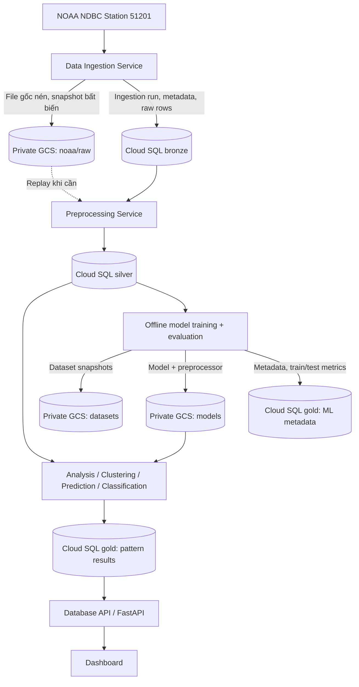

# WAIMEA WAVECAST — Database PostgreSQL 17 + Google Cloud Storage (v2.0)

**Phạm vi chốt:** **NOAA/NDBC Station 51201 là nguồn dữ liệu quan trắc duy nhất**. Không tạo các bảng Open-Meteo hoặc CDIP độc lập. Hệ thống dùng **Cloud SQL PostgreSQL 17** (`waimea_wavecast`) và **Google Cloud Storage (GCS)** (ví dụ bucket `gs://waimea-noaa/`). `Bronze / Silver / Gold` là **ba schema trong cùng một PostgreSQL database**. Tên bucket có thể đổi theo cấu hình bạn đã tạo.

> **Quan trọng:** SQL chỉ tạo cấu trúc và seed thông tin mô tả trạm, định nghĩa chỉ số, ba NOAA feeds; nó **không tải dữ liệu NOAA**, **không tự tạo bucket GCS** và **không huấn luyện mô hình**. Không có dữ liệu sóng giả. Cần xây dựng các service ingestion/preprocessing/training/inference sau bước này.

## I. Các tệp bàn giao

| Tệp | Khi nào chạy | Mục đích |
|---|---|---|
| `00_optional_create_database.sql` | **Không chạy** nếu đã có `waimea_wavecast` | Câu lệnh mẫu tạo DB trên instance mới bằng admin (đang comment) |
| `01_init_full.sql` | Lần đầu tạo đủ các bảng **hoặc** muốn rà soát bổ sung các object còn thiếu | 25 bảng, 5 view, 2 trigger, index, constraint, seed metadata, nâng cấp các cột v2 |
| `02_upgrade_from_v1.sql` | **Thay cho `01`** nếu 21 bảng v1 đã chạy thành công | Chỉ thêm 4 bảng, các cột GCS/ML mới, index, view mới; không đụng dữ liệu cũ |
| `03_verify.sql` | Chạy sau file `01` **hoặc** `02` | Kiểm tra chính xác cấu trúc và metadata |
| `DATA_DICTIONARY.md` | Đọc/tra cứu | Danh sách toàn bộ các trường, type và ràng buộc trong 25 bảng |

> **Không chạy đồng thời `01` và `02` theo thói quen.** `01` chứa sẵn tất cả nội dung v2. Các file được thiết kế để chạy lại mang tính cộng dồn, nhưng `CREATE TABLE IF NOT EXISTS` **không tự sửa những bảng mà ai đó đã chỉnh tay khác với thiết kế**. Với hệ thống đã có dữ liệu hoặc chỉnh sửa DDL thủ công, phải đối chiếu `03_verify.sql` và `DATA_DICTIONARY.md` trước khi nâng cấp.

## II. Sơ đồ kiến trúc



**Không nhầm lẫn:** NOAA quan trắc thực đo (có thể bị thiếu/cập nhật trễ) và mô hình *do nhóm tự train* để dự đoán tương lai. Nguồn dự báo ngoài NOAA không tham gia pipeline. Thu thập 30 phút/lần là chu kỳ *polling*, không bảo đảm NOAA có đúng một bản ghi mới sau mỗi 30 phút.

## III. Tổng số bảng và trách nhiệm từng schema

### Bronze — **6 bảng**, lịch sử nguồn, không xóa khi demo

| Bảng | PK / ràng buộc chính | Công dụng |
|---|---|---|
| `bronze.stations` | `station_id` | Trạm NOAA 51201, địa điểm, tọa độ, timezone, metadata |
| `bronze.measurement_definitions` | `noaa_code`; unique `silver_column` | 14 mã đo NOAA, ý nghĩa, đơn vị, mã thiếu |
| `bronze.source_feeds` | `feed_id`; unique `(station_id, feed_key)` | 3 luồng **cùng nguồn**: annual, monthly, realtime |
| `bronze.ingestion_runs` | `run_id` | Log API, thời gian, lỗi HTTP, số bản ghi mới/trùng/hiệu chỉnh |
| `bronze.source_files` | `file_id`; unique `(station_id, feed_id, content_sha256)` | Tệp NOAA, URL gốc, SHA-256, GCS URI/generation/CRC32C, trạng thái parser |
| `bronze.raw_observations` | `raw_id`; unique `(file_id, row_sha256)` | Dòng nguyên bản/JSONB từ file (tùy chế độ ingest), lưu dòng lỗi parse |

**GCS:** `source_files.gcs_uri`, `gcs_bucket`, `gcs_object_name`, `gcs_generation`, `gcs_crc32c` và `gcs_upload_status` liên kết byte gốc với một phiên bản object GCS. `SHA-256` của byte nguồn và `CRC32C` của object GCS là hai loại checksum **không tương đương**.

### Silver — **5 bảng**, quan trắc đã chuẩn hóa

| Bảng | PK | Công dụng |
|---|---|---|
| `silver.wave_observations` | `(station_id, observed_at)` | Một bản ghi hiện hành cho mỗi timestamp UTC/trạm; 14 cột NOAA |
| `silver.wave_observation_revisions` | `revision_id`; unique `(station_id, observed_at, revision_no)` | Lưu phiên bản khi dữ liệu/nguồn/QC thay đổi; trigger ghi snapshot JSONB |
| `silver.data_quality_issues` | `issue_id` | Lỗi timestamp, giá trị, sentinel, parse, QC |
| `silver.observation_gaps` | `gap_id` | Đoạn thiếu timestamp; khoảng 30 phút chỉ là giả định có điều kiện |
| `silver.daily_wave_features` | `(station_id, date_hst)` | Đặc trưng/tổng hợp theo **ngày Hawaii**, đầu vào phân tích, mô hình |

Tất cả timestamp đo là `TIMESTAMPTZ` (instant UTC), **không** lưu cả chuỗi datetime địa phương vào cột đo. Ngày Hawaii được tính theo `(observed_at AT TIME ZONE 'Pacific/Honolulu')::date`.

#### 14 biến NOAA được chuẩn hóa

| NOAA | Cột Silver | Type | Đơn vị / ghi chú |
|---|---|---|---|
| `WDIR` | `wind_direction_deg` | DOUBLE PRECISION | Độ hướng gió |
| `WSPD` | `wind_speed_ms` | DOUBLE PRECISION | m/s |
| `GST` | `wind_gust_ms` | DOUBLE PRECISION | m/s |
| `WVHT` | `wave_height_m` | DOUBLE PRECISION | m, sóng có nghĩa |
| `DPD` | `dominant_period_s` | DOUBLE PRECISION | s |
| `APD` | `average_period_s` | DOUBLE PRECISION | s |
| `MWD` | `mean_wave_direction_deg` | DOUBLE PRECISION | Độ hướng sóng |
| `PRES` (header cũ `BAR`) | `sea_level_pressure_hpa` | DOUBLE PRECISION | hPa |
| `ATMP` | `air_temperature_c` | DOUBLE PRECISION | °C |
| `WTMP` | `sea_surface_temp_c` | DOUBLE PRECISION | °C |
| `DEWP` | `dew_point_c` | DOUBLE PRECISION | °C |
| `VIS` | `visibility_nmi` | DOUBLE PRECISION | hải lý **sau khi đổi đơn vị**, đọc header (có file `mi`) |
| `PTDY` | `pressure_tendency_hpa` | DOUBLE PRECISION | hPa/3 giờ, có thể âm |
| `TIDE` | `tide_ft` | DOUBLE PRECISION | feet, có thể âm |

Các trường số cho phép `NULL`. Parser phải biến mã thiếu NOAA `MM`, `99`, `999`, `9999`, ... theo **từng cột và header tệp** thành `NULL` trước khi ghi Silver, tuyệt đối không coi sentinel là quan trắc hợp lệ. Cột có tên trong thiết kế không bảo đảm phao 51201 đo được biến đó ở mọi năm.

### Gold — **14 bảng**, kết quả và thông tin chạy mô hình

| Bảng | Công dụng |
|---|---|
| `gold.processing_runs` | Log các job analysis/aggregation/clustering/training/prediction/classification |
| `gold.time_series_metrics` | Thống kê ngày/tuần/tháng, line/scatter/histogram |
| `gold.trend_seasonal_components` | Phân rã trend / seasonal / residual |
| `gold.correlations` | Ma trận Pearson/Spearman trên cặp biến |
| `gold.model_registry` | Model version, thuật toán, feature, artifact URI, GCS generation, hash, train/test metadata |
| `gold.cluster_centroids` | Tâm cụm K-means, size, feature JSONB |
| `gold.cluster_assignments` | Cụm từng ngày Hawaii, khoảng cách tới centroid |
| `gold.classification_schemes` | Quy tắc/phiên bản nhãn sóng, không tự gán ngưỡng giả |
| `gold.predictions` | Kết quả dự đoán online/scheduled, thời điểm phát hành, target, actual và lỗi khi có thực tế |
| `gold.classifications` | Nhãn dự báo online, xác suất, đối chiếu thực tế |
| **`gold.dataset_splits`** | **Mới:** snapshot dataset ở GCS, features, nhãn, khoảng train/validation/test, data cutoff |
| **`gold.training_runs`** | **Mới:** từng lần training, config, seed, code, duration, logs, model tham chiếu |
| **`gold.model_evaluations`** | **Mới:** MAE/MSE/RMSE/R²; Accuracy/Precision/Recall/F1; Silhouette/DBI/CH theo task và stage |
| **`gold.evaluation_samples`** | **Mới:** predicted vs actual theo mẫu test, residual/error hoặc nhãn đúng/sai |

**Phân biệt:** `gold.evaluation_samples` phản ánh mô hình chạy trên dữ liệu test lịch sử (đánh giá offline); `gold.predictions` và `gold.classifications` lưu dự báo phát hành trong hoạt động thực, sau đó có thể được đối soát với NOAA. `gold.model_registry` là **model metadata**, còn tệp model thật nằm trên **GCS**.

**Lưu ý tiêu chí thí nghiệm:** MAE/RMSE/R² dùng cho *regression*; Precision/Recall/F1 dùng cho *classification*; Silhouette/DBI/Calinski–Harabasz dùng cho *clustering*. Không ép tất cả metrics đều có giá trị. Với bài toán regression/classification, chia train/test theo thời gian, không shuffle làm rò rỉ tương lai.

## IV. Thư mục đề xuất trong Google Cloud Storage

Tên bucket minh họa (theo tên bạn đang điền trên Console): `gs://waimea-noaa/`. Nếu bucket đã chọn tên khác, chỉ thay cấu hình trong Backend; SQL không hardcode tên bucket.

```text
gs://waimea-noaa/
├── noaa/
│   └── raw/
│       ├── historical/2005/<sha256>-51201h2005.txt.gz
│       ├── historical/2025/<sha256>-51201h2025.txt.gz
│       ├── monthly/2026/11/<sha256>.txt.gz
│       └── realtime/2026/11/07/<sha256>.txt
├── datasets/
│   ├── daily-features/<dataset-version>.parquet
│   └── training/<dataset-name>/<version>/dataset.parquet
├── models/
│   ├── regression/<model-version>/model.joblib
│   ├── regression/<model-version>/preprocessor.joblib
│   ├── classification/<model-version>/model.joblib
│   └── clustering/<model-version>/model.joblib
└── training-logs/<training-run-id>/train.json
```

Các object dùng **tên bất biến** theo SHA-256/phiên bản + GCS `if_generation_match=0` khi upload. Sau khi tải thành công, lưu `gs://...` và **generation** trả về; không coi URI là đủ để phân biệt phiên bản. Khi training, ghi manifest chứa feature list, window, target/horizon, split, code hash và checksum model. Không commit JSON key của service account vào repo; Backend VM nên dùng Application Default Credentials của service account được cấp quyền bucket tối thiểu.

GCS **không có table/schema PostgreSQL**. Vì vậy, ba schema không tự động ghi file lên GCS; Backend Ingestion/Training phải gọi thư viện Google Cloud Storage và sau đó ghi metadata vào Cloud SQL.

## V. Hướng dẫn chạy SQL trên DBeaver / Cloud SQL

### Kiểm tra kết nối

Mở DBeaver, chọn PostgreSQL connection, đúng database `waimea_wavecast` (không phải database `postgres`). Trong SQL Editor chạy:

```sql
SELECT current_database(), current_user, version();
```

### Chọn đúng **một** trong hai phương án

**Phương án A — Bạn chỉ tạo database + 3 schema, CHƯA chạy 21 bảng v1:**

1. Mở `01_init_full.sql`.
2. Chọn **Execute SQL Script** (DBeaver thường có `Alt+X`, hoặc dùng menu **SQL Editor → Execute SQL Script**). Không chỉ `Ctrl+Enter` dòng cuối.
3. Script mở `BEGIN;` và kết thúc `COMMIT;`; nếu gặp lỗi giữa chừng, chạy `ROLLBACK;`, xử lý lỗi rồi chạy lại.
4. Mở `03_verify.sql`, chạy toàn bộ. Mong đợi Bronze=6, Silver=5, Gold=14; 5 views; 14 metadata chỉ số; 3 feed.

**Phương án B — Bạn ĐÃ chạy đủ 21 bảng v1 trên Cloud SQL:**

1. **Không xóa các bảng cũ.** Sao lưu/snapshot Cloud SQL nếu đang có dữ liệu thật.
2. Mở `02_upgrade_from_v1.sql`, chạy toàn bộ.
3. Chạy `03_verify.sql` và Refresh các schema trong DBeaver.

`01_init_full.sql` cũng chứa phần nâng cấp nên có thể phát hiện/bổ sung các bảng còn thiếu; tuy nhiên khi v1 đang có dữ liệu thật, ưu tiên migration `02` tách biệt để kiểm toán thay đổi.

**Quyền:** tài khoản đang chạy cần là owner hoặc có quyền `CREATE` trong từng schema, và `ALTER` với các bảng hiện có để nâng cấp. `GRANT USAGE, CREATE ON SCHEMA` không tự động cho quyền `ALTER` trên bảng do role khác sở hữu. Nếu bị `must be owner of table`, hãy chạy nâng cấp bằng chủ sở hữu bảng hoặc role quản trị phù hợp.

Nếu DBeaver đã hoàn thành `01` hoặc `02`, bạn có thể kiểm tra nhanh:

```sql
SELECT table_schema, COUNT(*) AS tables
FROM information_schema.tables
WHERE table_schema IN ('bronze','silver','gold') AND table_type='BASE TABLE'
GROUP BY table_schema ORDER BY table_schema;
```

Nếu chưa thấy, trong Database Navigator → Databases → waimea_wavecast → Schemas → Refresh.

## VI. Quy trình incremental ingestion chính xác

1. **NOAA Historical Backfill:** nạp các file từ 2005 trở đi **nếu nguồn thật có**; không tự suy ra rằng tất cả năm đều có dữ liệu. Dữ liệu 2005/2006 có thể cần xem lại endpoint NOAA/THREDDS; chỉ lưu các quan trắc tìm thấy.
2. **Ghi nguồn GCS:** tải file, SHA-256 theo byte gốc, upload dưới tên bất biến (ưu tiên `if_generation_match=0`). Nếu object đã tồn tại (`412`), đọc lại metadata/generation thay vì ghi đè.
3. **Bronze `source_files`:** ghi file metadata bằng `ON CONFLICT (station_id, feed_id, content_sha256)`; ghi `gcs_generation`/`gcs_crc32c`, trạng thái upload; log `ingestion_runs`.
4. **Parser NOAA:** nhận biết header (`YYYY`/`YY`, cột `mm` có/không, `BAR`/`PRES`, đơn vị `VIS`...), chuyển sentinel theo field, log hàng lỗi. Có thể lưu `raw_observations` cho từng dòng để truy vết, nhưng tệp nguyên bản trên GCS là bản nguồn ưu tiên.
5. **Silver UPSERT** `(station_id, observed_at)`; không INSERT trùng, **annual > monthly > realtime** khi quyết định nguồn canonical. Trigger tạo revision khi giá trị/nguồn/QC thay đổi. Không xóa dữ liệu lịch sử đã có.
6. **Đối soát NOAA corrections:** theo lịch, kiểm tra lại tệp annual/monthly dù đã cache: cùng URL nhưng nội dung khác sẽ tạo SHA mới, GCS object mới và revision tương ứng. Không giả định file NOAA bất biến chỉ vì notebook đã tải một lần.
7. **Daily features:** resample theo `Pacific/Honolulu`, tính mean/median/max/p95, circular mean của hướng, flags và coverage. Cập nhật lại các ngày bị ảnh hưởng khi có correction.
8. **Gold patterns:** dựng lại bảng thống kê/seasonality/correlation/clustering dựa trên Silver. Inference dùng mô hình đã train, **không train lại khi chỉ xử lý timestamp mới**.

**Giới hạn transaction:** Upload GCS và commit PostgreSQL **không nguyên tử**. Nếu upload thành công nhưng SQL lỗi, lần sau dùng cùng SHA/object name để retry idempotent; nếu upload lỗi thì không đánh dấu `verified`. Không gán nhãn `success` cho bước còn thiếu. Cần xử lý `409/412`, HTTP retry và connection timeout riêng trong Backend.

## VII. Quy trình training, evaluation và inference

1. Chọn nhãn (ví dụ dự đoán `WVHT` của **ngày Hawaii kế tiếp**) và feature có sẵn *tại thời điểm dự đoán*. Không để thông tin ngày mai lọt vào feature.
2. `silver.daily_wave_features` → tạo feature lag/rolling windows, split theo thời gian, lọc ngày thiếu rõ quy tắc.
3. Xuất dataset snapshot `.parquet` vào GCS; tạo `gold.dataset_splits` gồm train/val/test, `dataset_sha256`, `dataset_gcs_uri`, `dataset_gcs_generation`.
4. Tạo `gold.training_runs` status `running`; train mô hình; nếu thất bại ghi `failed` và error.
5. Đánh giá trên validation/test; tạo `gold.model_evaluations` và (nếu cần) `gold.evaluation_samples`; có thể lưu chi tiết lớn lên GCS.
6. Lưu model/scaler/pipeline vào prefix GCS bất biến. Tạo `gold.model_registry` artifact URI, generation, hash, feature names; gắn `training_runs.model_id` sau khi artifact đã kiểm tra.
7. Backend Prediction Service tải model đáng tin cậy và cache khi khởi động; khi nhận NOAA mới tạo feature tương thích model, suy luận và lưu `gold.predictions`/`gold.classifications`.
8. Khi NOAA công bố actual của ngày target, cập nhật `actual_value` và `absolute_error` hoặc nhãn thực tế; quan sát hiệu năng live **khác** metrics held-out historical.

**Ví dụ nội dung `model_evaluations`:** regression lưu MAE, RMSE, R²; classification lưu accuracy, macro-precision, macro-recall, macro-F1, confusion matrix; clustering lưu silhouette (và DBI/CH nếu phù hợp). Có thể lưu baseline để chứng minh model tốt hơn dự đoán ngây thơ. Không đưa số metrics giả khi chưa huấn luyện.

## VIII. Demo cuối kỳ — bảng nào có thể xóa và tái tạo?

**Nên xóa/tái tạo CHỈ các bảng pattern đầu ra** trên môi trường demo và sau khi chuẩn bị script khôi phục: `gold.time_series_metrics`, `gold.trend_seasonal_components`, `gold.correlations`, `gold.cluster_assignments`, `gold.predictions`, `gold.classifications` (và các kết quả do service sinh ra theo quy trình nhóm).

**Không xóa:** toàn bộ `bronze.*`, `silver.*`, `gold.model_registry`, `gold.dataset_splits`, `gold.training_runs`, `gold.model_evaluations`, `gold.evaluation_samples`, `gold.cluster_centroids` khi dùng lại model K-means, `gold.classification_schemes`. Không xóa GCS `noaa/raw`, dataset snapshot hay artifact model. Nếu xóa `gold.processing_runs`, hãy kiểm tra các FK từ bảng pattern; không cần xóa log để demo.

Các thao tác demo xóa dữ liệu phải giới hạn trong tài nguyên đồ án/DB test và thực hiện sau khi sao lưu. **Không có lệnh TRUNCATE/DROP trong bộ SQL tạo cấu trúc** để tránh nhầm lẫn.

## IX. Bảo mật, vận hành và chi phí

- **PostgreSQL**: không đưa password vào SQL source / Github / Frontend. Kết nối Cloud SQL từ Backend theo phương án an toàn (Cloud SQL Auth Proxy hoặc kết nối TLS + Authorized Networks), dùng secret/env được bảo vệ.
- **GCS**: bucket private, Public Access Prevention Enforced, Uniform Bucket-Level Access. Cho Backend service account đọc/ghi object đúng bucket; không cần tài khoản Google riêng cho mỗi thành viên nhóm nếu không có nhu cầu làm việc trực tiếp.
- **Model `.joblib`/`.pkl`**: chỉ tải các artifact do nhóm kiểm soát và xác minh checksum/generation; định dạng pickle có thể thực thi mã khi deserialize.
- Dữ liệu NOAA ~hàng trăm nghìn bản ghi là quy mô không lớn với PostgreSQL; chưa cần partition hay BigQuery. Hãy đo kích thước thực tế sau ingest.
- Soft delete GCS 7 ngày và backup Cloud SQL giúp giảm rủi ro nhưng có phí; không thay thế chiến lược kiểm tra khôi phục.
- Khi deploy, thêm các migration vào repo `waimea-wavecast-backend/database/migrations/` và chạy tự động có kiểm soát, không chỉnh schema tùy tiện ở production.

## X. Truy vấn sử dụng sau khi có dữ liệu

```sql
-- Độ cao sóng 48 giờ gần nhất (UTC instant)
SELECT station_id, observed_at, wave_height_m, dominant_period_s, quality_status
FROM silver.wave_observations
WHERE station_id='51201' AND observed_at >= NOW() - INTERVAL '48 hours'
ORDER BY observed_at DESC;

-- Khối lượng dữ liệu theo năm UTC, không bịa hàng 2005/2006
SELECT EXTRACT(YEAR FROM observed_at AT TIME ZONE 'UTC')::int AS year_utc,
       COUNT(*) AS total, COUNT(wave_height_m) AS has_wave_height
FROM silver.wave_observations
GROUP BY 1 ORDER BY 1;

-- Mô hình đạt kết quả tốt trên tập test (đơn vị MAE của target)
SELECT model_name, model_version, dataset_name, dataset_version,
       sample_count, mae, rmse, r2_score, evaluated_at
FROM gold.v_model_evaluation_summary
WHERE task_type='regression' AND evaluation_stage='test'
ORDER BY mae ASC NULLS LAST, evaluated_at DESC;

-- Liệt kê object GCS chưa được xác minh
SELECT file_id, original_filename, gcs_uri, gcs_generation, gcs_upload_status
FROM bronze.source_files
WHERE gcs_upload_status <> 'verified'
ORDER BY fetched_at DESC;
```

## XI. Kết quả kỳ vọng và giới hạn kiểm tra

Chạy file `03_verify.sql` phải cho thấy **6 Bronze + 5 Silver + 14 Gold = 25 bảng**, **5 views**, **14 NOAA measurement definitions**, **3 NOAA feeds**, **2 trigger trên wave_observations**, metadata trạm `51201`. Các bảng số liệu chưa có row khi chưa ingestion là đúng.

Bộ SQL này được kiểm tra cấu trúc/tính nhất quán tĩnh từ file nguồn v1 và notebook NOAA; **chưa thực thi trên Cloud SQL cá nhân của bạn**, nên khi chạy hãy gửi nguyên thông báo DBeaver nếu gặp lỗi quyền hoặc schema khác v1. Script khởi tạo **không tự cấu hình IAM GCS**.

**Tài liệu tham khảo:**
- Yêu cầu đồ án / bài giảng: `TONG_HOP_KIEN_THUC_VA_DO_AN_CUOI_KY.md` (đã dùng để đối chiếu các service, pattern và kịch bản demo).
- NOAA NDBC Historical: https://www.ndbc.noaa.gov/data/historical/stdmet/
- NOAA NDBC realtime 51201: https://www.ndbc.noaa.gov/data/realtime2/51201.txt
- NOAA Station History 51201: https://www.ndbc.noaa.gov/station_history.php?station=51201
- Google Cloud GCS generation conditions: https://cloud.google.com/storage/docs/request-preconditions
