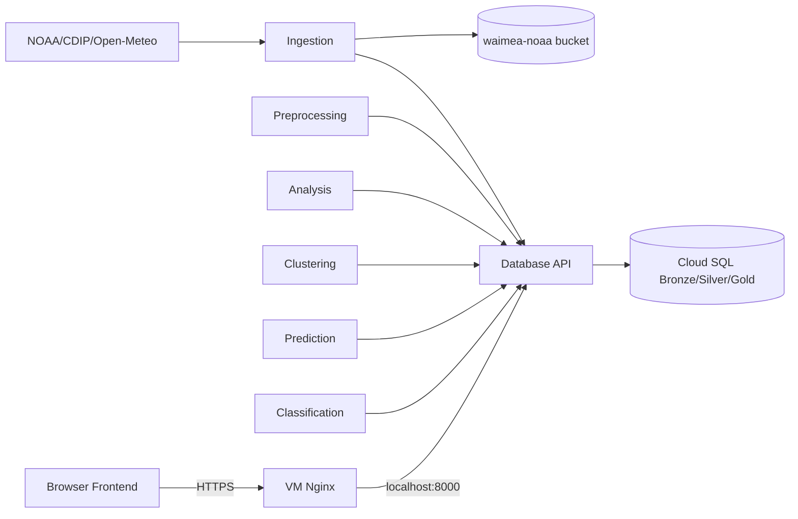

# Waimea WaveCast backend topology

- CDIP 106 and NOAA 51201 share **one physical buoy**.
- Open-Meteo is **model** data; `issued_at` differs from `valid_at`. Do not mix with observations.
- Compute Engine VM service account accesses GCS through ADC. PostgreSQL access uses `DB_USER` and `DB_PASSWORD` over TLS.
- GCS uses one private bucket with prefixes for raw data, datasets, models, reports, evaluations and predictions. See `storage/gcs_layout.md`.
- Database API connects directly to `dbwaimea.liems.io.vn:5432`; VM DNS and network routing must reach the Cloud SQL address.
- Nginx is a **host process**, TLS via Certbot. Docker Compose binds API only to loopback `127.0.0.1:8000`.
- Public access allowed to TCP 80/443 for the VM; SSH restricted through IAP. Do not open database port publicly.
- Store UTC timestamps in DB and compute calendar day as Pacific/Honolulu.
- `dbwaimea.liems.io.vn` optional private DNS; not exposed to Internet.
